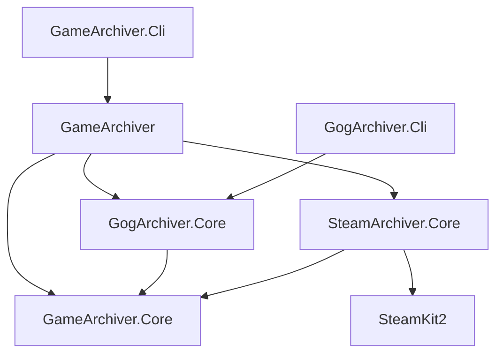

# GameArchiver C# API

Projects, assemblies and namespaces use `GameArchiver`, `GogArchiver` and `SteamArchiver`.
Update consumer references and `using` directives after the rename; the aggregate client is
`GameArchiverClient`. Persistent configuration/staging paths, environment variables and metadata
formats retain their previous names, so existing credentials and backups remain usable.

All projects target .NET 9. A store client can be used independently, without a CLI or the
aggregator. Libraries do not read from or write to the console. They accept cancellation and
progress callbacks. The Steam provider uses the SteamKit2 NuGet package directly; it never
starts DepotDownloader or SteamCMD.

## Project boundaries



`GameArchiver.Core` owns `IGameStore`, source-qualified models, metadata, staging path checks,
link expansion, archive naming, ZIP writing/verification/repair, and atomic publication.
It has no reference to either provider. The original public ZIP/rate limiter type names are
retained in that assembly and forwarded by the GOG assembly for compatibility; new application
code can use the neutral `ArchivePublisher`, `ArchiveStorage` and metadata APIs.

`GogClient` owns GOG authentication, snapshot synchronization, DLC/pack selection, depots and
installer extraction. `SteamClient` owns Steam authentication, licensing, appinfo, depot selection,
manifest/chunk transfers, and file reconstruction. The aggregator registers store instances and
routes by source; neither provider references the aggregator or the other provider.

## Independent GOG client

```csharp
using GameArchiver.Core;
using GogArchiver.Core;

await using var gog = new GogClient();

// First login: show gog.LoginUrl in your UI and obtain the returned authorization URL/code.
// await gog.LoginAsync(authorizationUrl, cancellationToken);

var snapshot = await gog.SyncGogLibraryAsync(ct: cancellationToken);
var result = await gog.DownloadAsync("1456460669", new ArchiveOptions
{
    OutputRoot = "/backups",
    StagingRoot = "/local/staging",
    Platform = GameOs.Windows,
}, ct: cancellationToken);
```

`SyncGogLibraryAsync` returns the detailed existing `LibrarySnapshot`. The common
`SyncLibraryAsync` returns `StoreLibraryResult` with normalized games and per-product failures.
`GogClientOptions` can select the original snapshot/token paths and GOG HTTP settings. Existing
low-level APIs (`GogApiClient`, `LibrarySync`, `GameDownloader`) remain available. The injected
GOG constructor leaves supplied HTTP clients owned by its caller.

`GetVersionAsync` refreshes the selected platform, owned DLC and language sizes from GOG,
and updates that client's in-memory selection for a subsequent download. Downloads otherwise
use the last snapshot; synchronize before a batch to update the library. Partial sync retains
previous entries for products whose refresh failed. Operations on one client are serialized.
GOG versions use an empty `Architecture`, since GOG's content selection does not use that field.

GOG does not support the Steam branch selector. A non-public branch is rejected explicitly.
Selecting DLC with one known depot-backed parent selects the parent; multiple parents require
an explicit base-game selection. Automatic batch selection preserves the original platform-aware
DLC and pack rules. Installer-only DLC is not silently merged into the base installer.

## Independent Steam client

```csharp
using GameArchiver.Core;
using SteamArchiver.Core;

await using var steam = new SteamClient(new SteamClientOptions
{
    Authenticate = async (challenge, ct) =>
    {
        // Supply these through your application's UI. Nothing prompts inside the library.
        if (challenge.Kind == SteamChallengeKind.DeviceConfirmation)
            return "approve"; // start polling while the user approves in the mobile app
        return await ReadSteamGuardCodeFromYourUiAsync(challenge, ct);
    },
});

// Only needed to establish/replace the remembered session. Passwords are never stored.
// await steam.LoginAsync(new SteamCredentials(accountName, password), cancellationToken);

var library = await steam.SyncLibraryAsync(cancellationToken);
var version = await steam.GetVersionAsync("427520", new GameSelection
{
    Platform = GameOs.Windows,
    Language = "en",
    Architecture = "64",
    Branch = "public",
}, cancellationToken);

var result = await steam.DownloadAsync("427520", new ArchiveOptions
{
    OutputRoot = "/backups",
    StagingRoot = "/local/staging",
    Platform = GameOs.Windows,
    MaxConnections = 5,
    MaxBytesPerSecond = 5 * 1024 * 1024,
}, ct: cancellationToken);
```

The example's UI callback and account variables belong to the host application. Returning
`"approve"` for device confirmation permits mobile approval; return another value to request
code entry instead. Email/device-code challenges include the previous-code rejection state.
`SteamClientOptions.TokenPath` selects the remembered session file and `OperationTimeout` bounds
connection/authentication/protocol requests. Refresh and guard tokens are persisted atomically
with private Unix creation permissions. `GetAuthenticationAsync` reads saved credentials without
contacting Steam; it does not prove they are still valid. `LogoutAsync` disconnects and removes
them. A disconnected session is recreated on the next operation.

An injected `ISteamSession` supplies a controlled protocol boundary for embedding/tests and is
owned by `SteamClient`. It returns licensed AppIDs, parsed appinfo and a content session. The
default implementation is `SteamKitSession`; it uses CM callbacks, license/package tokens, PICS,
Steam Guard and SteamPipe through SteamKit2. Library metadata is requested in batches.

## Aggregate API

```csharp
using GameArchiver;
using GameArchiver.Core;
using GogArchiver.Core;
using SteamArchiver.Core;

await using var archive = new GameArchiverClient(new GogClient(), new SteamClient());

ArchiveLibrary? previous = File.Exists(ArchiveLibrary.DefaultPath)
    ? await ArchiveLibrary.LoadAsync(ArchiveLibrary.DefaultPath, cancellationToken)
    : null;
var library = await archive.SyncLibraryAsync(previous, cancellationToken);
await library.SaveAsync(ArchiveLibrary.DefaultPath, cancellationToken);

var options = new ArchiveOptions { OutputRoot = "/backups", Platform = GameOs.Windows };
var result = await archive.DownloadAsync(new GameKey("steam", "427520"), options,
    new InlineProgress<ArchiveProgress>(p => UpdateYourUi(p)), cancellationToken);
var differences = await archive.DiffAsync(library, options, ct: cancellationToken);
var checks = await archive.VerifyAsync("/backups", deep: true, ct: cancellationToken);
```

The aggregator owns its stores by default. Use the constructor accepting `ownsStores: false`
when the host owns their lifetime. Methods do not authenticate by reading console input:
establish credentials through the individual clients before calling common operations.

`GameKey("gog", "1")` and `GameKey("steam", "1")` identify different products. Slugs/titles never
establish identity. The source is case-normalized; the product ID remains a string. Duplicate
store registrations and duplicate/mismatched identities from a sync are rejected.

A failed source retains its previous products when a previous snapshot is supplied. A partial
product failure retains that product and records a qualified failure key. Source-filtered sync
preserves unselected sources and their failures. Offline diff does not present retained
failed-sync entries as current; a successful live version refresh can establish their status.
`StoreLibraryResult.Failures` uses product IDs; `ArchiveLibrary.Failures`
qualifies those IDs with their source, or uses the source alone for a whole-source failure.

`DiffAsync` compares saved library metadata by default. Steam sync records the exact base-game,
shared and owned-DLC manifest selection for each OS using English, 64-bit and the public branch.
This detects DLC-only updates even when the base build ID stays the same. `refreshVersions: true`
authenticates as needed and fetches the exact selected depot configuration. Other selections,
unavailable defaults and older Steam snapshots without manifest IDs require a refresh and are
reported as `Unknown` offline. GOG installer versions set
`BuildVariesByLanguage`; comparing a different language requires a live refresh too.
`VerifyAsync` checks archive integrity and recorded archive size; its optional `platform`
filter limits checks to one OS, and repair takes the output lease before modifying anything.
Verification does not prove a title can run without Steam/DRM. `FindOrphansAsync` reports known
supported-source backups outside the supplied library and never deletes them.

## Metadata, folders and recovery

Native Steam archives use `.gamebackup.json` schema 2 with `Source`, string `ProductId`, `Slug`,
`Title` and per-OS `Platforms`. Each completion records the build, branch, language, architecture,
depot manifest IDs, owned DLC selection, measured installed/archive sizes, file hashes, launch
metadata and runtime requirement. There is no temporary signed CDN URL in permanent metadata.

Existing GOG archives keep `.gogdl.json` so the original CLI can continue updating them. The
common reader maps `GameId` to a string `ProductId` and missing `Source` to `gog`. Foreign-source
legacy metadata is ignored before parsing GOG-specific fields. If both metadata files identify
different owners, operations fail. A GOG legacy manifest is authoritative when both describe
the same product, since the original CLI may have updated it independently.

Existing folders are found by metadata identity. The second store's copy may use a readable
`{slug}_{source}` alias. Same-store, unidentified or occupied alias collisions require an explicit
`DirectoryName` (`--directory` in the CLI). An explicit name chooses a new backup's location;
it does not rename an already identified backup. Manual folder renames remain discoverable.
Allocation rejects multiple case-equivalent entries for the chosen name or alias, including
empty folders, before claiming ownership.
The GOG `{slug}__{id}` layout migrates to its slug without rebuilding a completed ZIP.

Output and staging leases prevent concurrent writers from assembling/publishing the same files.
A short library-root reservation serializes folder allocation across providers and processes;
ownership metadata uses exclusive creation so a competing claim cannot replace an owner.
Cancellation finishes an already-started ownership write. An I/O failure during that small write
leaves an invalid claim and subsequent allocation fails safely instead of adopting the folder.
Steam resumes full files and chunks only after SHA-1 verification and removes unplanned staging
paths. Reuse from previous ZIPs is also rehashed. Steam archives include a content-selection
fingerprint in the version tag, so changing DLC/language/manifests cannot overwrite the previous
ZIP before the replacement metadata commits. Staging markers and lock files live outside the ZIP.

## Current Steam scope and verification

Public and unencrypted branches with accessible manifests are supported. Password-protected
branches, Workshop content, redistributable installation and DRM removal are not implemented.
Architecture and language constraints are checked for both base-game and owned-DLC depots.
If a constrained selection has no match, downloading fails instead of publishing only the
neutral depots. Select `Architecture = "32"` explicitly for a 32-bit-only release.
The provider stores a launch task only when its executable exists in the selected file plan;
it does not generate a replacement Steam launcher. `WriteLauncher` controls GOG's existing
launcher generation. Steam Windows archives are marked as requiring a setup/runtime step in
GameVault naming, with the actual portability requirement recorded as unverified.

Tests cover both standalone APIs, aggregate routing, mixed-store identities/aliases, legacy GOG
migration, Steam DLC overrides, OS/language/branch selection, chunk resume, hash failures, corrupt
cache reuse, unsafe paths/links, concurrent claims, token permissions and HTTP cancellation.
Real Steam Guard login, licensed CDN access and ARM64 execution require a real account/device;
they have not been live-verified in this implementation session.
