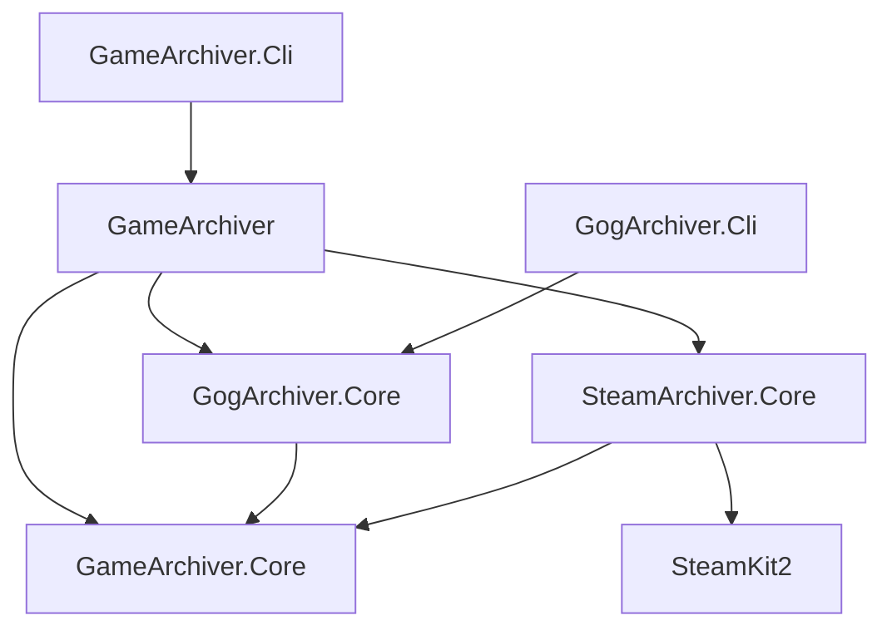

# GameArchiver C# API

Projects, assemblies and namespaces use `GameArchiver`, `GogArchiver` and `SteamArchiver`.
Update consumer references and `using` directives after the rename; the aggregate client is
`GameArchiverClient`. Persistent configuration/staging paths and environment variables retain
their previous names. Archive metadata now uses the visible `gamearchiver.json` filename for
both providers; old names remain readable and migrate on download or an explicit migration.

All projects target .NET 9. A store client can be used independently, without a CLI or the
aggregator. Libraries do not read from or write to the console. They accept cancellation and
progress callbacks. The Steam provider uses the SteamKit2 NuGet package directly; it never
starts DepotDownloader or SteamCMD.

## Project boundaries



`GameArchiver.Core` owns `IGameStore`, source-qualified models, metadata, staging path checks,
link expansion, archive naming, ZIP writing/verification/repair, and atomic publication.
It has no reference to either provider. The original public ZIP/rate limiter type names are
retained in that assembly and forwarded by the GOG assembly for compatibility; new application
code can use the neutral `ArchivePublisher`, `ArchiveStorage` and metadata APIs.

`GogClient` owns GOG authentication, snapshot synchronization, DLC/pack selection, depots and
installer extraction. `SteamClient` owns Steam authentication, licensing, appinfo, depot selection,
manifest/chunk transfers, and file reconstruction. The aggregator registers store instances and
routes by source; neither provider references the aggregator or the other provider.

## Independent GOG client

```csharp
using GameArchiver.Core;
using GogArchiver.Core;

await using var gog = new GogClient();

// First login: show gog.LoginUrl in your UI and obtain the returned authorization URL/code.
// await gog.LoginAsync(authorizationUrl, cancellationToken);

var snapshot = await gog.SyncGogLibraryAsync(ct: cancellationToken);
var result = await gog.DownloadAsync("1456460669", new ArchiveOptions
{
    OutputRoot = "/backups",
    StagingRoot = "/local/staging",
    Platform = GameOs.Windows,
}, ct: cancellationToken);
```

`SyncGogLibraryAsync` returns the detailed existing `LibrarySnapshot`. The common
`SyncLibraryAsync` returns `StoreLibraryResult` with normalized games and per-product failures.
`GogClientOptions` can select the original snapshot/token paths and GOG HTTP settings. Existing
low-level APIs (`GogApiClient`, `LibrarySync`, `GameDownloader`) remain available. The injected
GOG constructor leaves supplied HTTP clients owned by its caller.

`GetVersionAsync` refreshes the selected platform, owned DLC and language sizes from GOG,
and updates that client's in-memory selection for a subsequent download. Downloads otherwise
use the last snapshot; synchronize before a batch to update the library. Partial sync retains
previous entries for products whose refresh failed. Operations on one client are serialized.
GOG versions use an empty `Architecture`, since GOG's content selection does not use that field.

GOG does not support the Steam branch selector. A non-public branch is rejected explicitly.
Selecting DLC with one known depot-backed parent selects the parent; multiple parents require
an explicit base-game selection. Automatic batch selection preserves the original platform-aware
DLC and pack rules. Installer-only DLC is not silently merged into the base installer.

## Independent Steam client

```csharp
using GameArchiver.Core;
using SteamArchiver.Core;

await using var steam = new SteamClient(new SteamClientOptions
{
    Authenticate = async (challenge, ct) =>
    {
        // Supply these through your application's UI. Nothing prompts inside the library.
        if (challenge.Kind == SteamChallengeKind.DeviceConfirmation)
            return "approve"; // start polling while the user approves in the mobile app
        return await ReadSteamGuardCodeFromYourUiAsync(challenge, ct);
    },
});

// Only needed to establish/replace the remembered session. Passwords are never stored.
// await steam.LoginAsync(new SteamCredentials(accountName, password), cancellationToken);

var library = await steam.SyncLibraryAsync(cancellationToken);
var version = await steam.GetVersionAsync("427520", new GameSelection
{
    Platform = GameOs.Windows,
    Language = "en",
    Architecture = "64",
    Branch = "public",
}, cancellationToken);

var result = await steam.DownloadAsync("427520", new ArchiveOptions
{
    OutputRoot = "/backups",
    StagingRoot = "/local/staging",
    Platform = GameOs.Windows,
    MaxConnections = 5,
    MaxBytesPerSecond = 5 * 1024 * 1024,
}, ct: cancellationToken);
```

The example's UI callback and account variables belong to the host application. Returning
`"approve"` for device confirmation permits mobile approval; return another value to request
code entry instead. Email/device-code challenges include the previous-code rejection state.
`SteamClientOptions.TokenPath` selects the remembered session file and `OperationTimeout` bounds
connection/authentication/protocol requests. Up to three initial connection attempts and their
retry delays share one timeout budget; authentication itself is not automatically retried.
Disconnection errors identify the phase of the operation. Refresh and guard tokens are persisted
atomically with private Unix creation permissions. `GetAuthenticationAsync` reads saved credentials without
contacting Steam; it does not prove they are still valid. `LogoutAsync` disconnects and removes
them. A disconnected session is recreated on the next operation.

An injected `ISteamSession` supplies a controlled protocol boundary for embedding/tests and is
owned by `SteamClient`. It returns licensed AppIDs, parsed appinfo and a content session. The
default implementation is `SteamKitSession`; it uses CM callbacks, license/package tokens, PICS,
Steam Guard and SteamPipe through SteamKit2. Library metadata is requested in batches.
Steam sync and version queries populate `GameVersion.DownloadSize` and `InstalledSize` from
the final selected depot manifests, including owned DLC and deduplicating shared depots.
If any selected depot lacks a size, the corresponding total is zero (unknown). GOG installer
versions use the selected installer size for `DownloadSize`. These are full-content estimates,
independent of cache/resume savings, and do not change content-version identity.
Missing-token appinfo responses receive one individual token/product-info retry. Persistent
errors include token states and licensing package IDs without exposing token values.
`ISteamSession.GetAppNamesAsync` is an optional label lookup with an empty default implementation.
The native session uses PICS names and, for missing labels, a bounded `Player.GetOwnedGames`
request. Names never supply ownership or downloadable content. `StoreLibraryResult.FailureNames`
and `ArchiveLibrary.FailureNames` carry optional display names for failed IDs; older snapshots
remain readable. The aggregator also retains names from previous snapshots during failures.
`FailureSummaries` on both result types provides optional concise display text; `Failures`
always retains the full diagnostics and determines failure status. The CLI defaults to a
summary when available and accepts `--details` to show the full diagnostic. Refresh replaces
summaries for the selected source so stale diagnoses cannot label new failures.

Despite the historical `Games` property name, the list contains products of all returned
types (`GameInfo.Kind`), including DLC, applications, demos and tools. Steam first unions
AppIDs from active license packages; several licenses for the same AppID produce one entry.
Shared package membership or a matching title never merges different AppIDs or dismisses an
unresolved appinfo failure. The aggregate snapshot can also retain old entries for failed
products and unselected providers; its total is not the number of newly refreshed games.

`SteamClient.GetOwnedGamesAsync(ct)` reads the full diagnostic list through the existing
SteamKit2 session and returns AppID/name pairs. It requests free games including unplayed
titles, free packages and unvetted apps, without an AppID filter. A compatibility extension
sends `include_all_free_games` as protobuf field 10 because SteamKit2 3.4.0 lacks that property.
This is separate from PICS-derived ownership and
does not provide download authorization. The method is serialized with other client operations;
it does not sync or mutate archive metadata. `ISteamSession.GetOwnedGamesAsync` has a default
implementation that throws `NotSupportedException` for transports without this diagnostic.
The native session checks the service result, explicit response count, positive unique IDs
and list length before returning; failures and cancellation propagate instead of becoming an
empty list. The unified `library compare --source steam` command uses this API against a saved
snapshot, with names for any still-unresolved AppIDs found in the returned list.

## Aggregate API

```csharp
using GameArchiver;
using GameArchiver.Core;
using GogArchiver.Core;
using SteamArchiver.Core;

await using var archive = new GameArchiverClient(new GogClient(), new SteamClient());

ArchiveLibrary? previous = File.Exists(ArchiveLibrary.DefaultPath)
    ? await ArchiveLibrary.LoadAsync(ArchiveLibrary.DefaultPath, cancellationToken)
    : null;
var library = await archive.SyncLibraryAsync(previous, cancellationToken);
await library.SaveAsync(ArchiveLibrary.DefaultPath, cancellationToken);

var options = new ArchiveOptions
{
    OutputRoot = "/backups", Platform = GameOs.Windows, Layout = ArchiveLayout.Provider,
    ProviderDirectories = new() { ["gog"] = "drm_free", ["steam"] = "steam" },
};
var result = await archive.DownloadAsync(new GameKey("steam", "427520"), options,
    new InlineProgress<ArchiveProgress>(p => UpdateYourUi(p)), cancellationToken);
var differences = await archive.DiffAsync(library, options, ct: cancellationToken);
var checks = await archive.VerifyAsync(options, deep: true, ct: cancellationToken);
var orphans = await archive.FindOrphansAsync(library, options, cancellationToken);
```

The aggregator owns its stores by default. Use the constructor accepting `ownsStores: false`
when the host owns their lifetime. Methods do not authenticate by reading console input:
establish credentials through the individual clients before calling common operations.

Register only the providers an operation should use, for example
`new GameArchiverClient(new GogClient())` for GOG. Additional `IGameStore` implementations use
the same output routing; provider names are not hard-coded in the shared API.

`ArchiveLayout.Flat` is the default. `ArchiveLayout.Provider` places game folders under
`OutputRoot/{source}/`, with optional single-folder overrides in `ProviderDirectories`.
The same options work with standalone `GogClient` and `SteamClient` downloads. Pass those
options to `DiffAsync`, `VerifyAsync` and `FindOrphansAsync` to inspect the same destinations.
The string-root overloads of verification and orphan discovery retain flat-layout behavior.
Routing leaves local staging settings unchanged, rejects ambiguous names, files, links and
game backups occupying a provider directory, and reserves provider folders before allocating
games. Changing the layout does not migrate existing archives; complete game folders can be
moved manually while downloads are stopped and will be rediscovered by metadata identity.

`GameKey("gog", "1")` and `GameKey("steam", "1")` identify different products. Slugs/titles never
establish identity. The source is case-normalized; the product ID remains a string. Duplicate
store registrations and duplicate/mismatched identities from a sync are rejected.

A failed source retains its previous products when a previous snapshot is supplied. A partial
product failure retains that product and records a qualified failure key. Source-filtered sync
preserves unselected sources and their failures. Offline diff does not present retained
failed-sync entries as current; a successful live version refresh can establish their status.
`StoreLibraryResult.Failures` uses product IDs; `ArchiveLibrary.Failures`
qualifies those IDs with their source, or uses the source alone for a whole-source failure.

`DiffAsync` compares saved library metadata by default. Steam sync records the exact base-game,
shared and owned-DLC manifest selection for each OS using English, 64-bit and the public branch.
This detects DLC-only updates even when the base build ID stays the same. `refreshVersions: true`
authenticates as needed and fetches the exact selected depot configuration. Other selections,
unavailable defaults and older Steam snapshots without manifest IDs require a refresh and are
reported as `Unknown` offline. GOG installer versions set
`BuildVariesByLanguage`; comparing a different language requires a live refresh too.
`VerifyAsync` checks archive integrity and recorded archive size; its optional `platform`
filter limits checks to one OS, and repair takes the output lease before modifying anything.
Verification does not prove a title can run without Steam/DRM. `FindOrphansAsync` reports known
supported-source backups outside the supplied library and never deletes them.

## Bulk archive file operations

`GameArchiverClient.ProcessArchiveFilesAsync` operates on completed ZIPs discovered by metadata
under the configured output/layout. It uses registered stores only to select sources; no store
method is called and no library snapshot is needed. Both GOG legacy and native metadata are
supported, including archives no longer listed in the online library.

```csharp
var options = new ArchiveOptions { OutputRoot = "/backups", Layout = ArchiveLayout.Provider };
var request = new ArchiveFileRequest
{
    Operation = ArchiveFileOperation.Replace,
    FilePath = "/home/user/replacement.txt",
    Match = "readme.txt",
    MatchBy = ArchiveFileMatch.Name, // Path matches the full relative entry path instead
    IgnoreCase = true,
    DryRun = true,
    Platform = GameOs.Windows,      // null includes every archived platform
};
var preview = await archive.ProcessArchiveFilesAsync(options, request, ct: cancellationToken);
var results = await archive.ProcessArchiveFilesAsync(options, request with { DryRun = false }, ct: cancellationToken);
```

Use `Operation = Find` without `FilePath` to list matches. Use `Operation = Add` with `FilePath`
and optional `EntryPath` to insert the same file into each ZIP (default: source basename at root).
`Search` filters game title/slug. Match strings are literal, case-sensitive by default.
Results carry the game key, platform, ZIP path, status, per-entry destination/backup paths and
any error or cleanup warning. Failures are reported per archive and the batch continues;
cancellation throws `OperationCanceledException`. `DryRun` does not create locks or staging.

An existing entry is renamed with a `.backup` suffix, repeated until unoccupied. Old backups
remain intact. Unsafe paths, case-colliding entries, directory/file conflicts, encrypted ZIPs,
unsupported compression and inconsistent headers are refused. ZIP64 and streaming data descriptors
are supported. Unchanged compressed payloads are copied with bounded buffers; newly inserted
content is verified. Original creator and Unix mode fields survive raw-copy edits; replacements
retain the target's permissions, and new entries use the source file's mode when available.
`verify --deep` remains the way to check every existing payload.

Edits take the same archive lease as downloads. They publish to a unique `(local-<id>).zip` name,
then atomically update the authoritative metadata, and only then delete the previous ZIP.
Failure before the metadata commit preserves the previous backup. Crashes can leave unreferenced
files; the next operation scans only metadata-referenced ZIPs. Both size fields and modified file
hashes are updated (MD5 for GOG legacy, SHA1 for native metadata); original hashes follow their
backup entries. Provider fields, download version and `CompletedAt` are retained, and `ModifiedAt`
records the edit. Edits migrate metadata before publication. The canonical file takes precedence
over old names; without it, recognized `.gogdl.json` wins over `.gamebackup.json` for the same GOG
owner. An explicitly foreign `.gogdl.json` is left untouched. `ArchiveMetadata.LoadedFileName`
and `LoadedGogFormat` record the authoritative file and payload format in memory only.
Edits compare normalized archive paths across platforms and
refuse shared ZIPs before writing. Local-edit filenames fit 255 UTF-8 bytes without splitting
Unicode characters or dropping GameVault type tags; long title/version text may be shortened.
Temporary files use independent short names. Preview validates the same naming constraints.
Custom edits are not reapplied automatically when a later download rebuilds an archive.

## Metadata, folders and recovery

`DrmInfo` represents a reported `Unknown`, `Free` or `Protected` status with `Source`, `Url`,
`CheckedAt`, `Notes` and `Branch`. `GameInfo.Drm` is keyed by OS; `ArchiveLibrary.DrmOverrides`
is keyed by `source:ID` and OS. `DrmCatalog.Get(library, key, os, branch)` resolves a manual
override, the saved community report, then the GOG distribution-policy default or unknown.
No report applies to another OS or branch, and unknown is never treated as free.

```csharp
using var source = new PcGamingWikiDrmSource();
var refreshed = await LibraryDrm.RefreshAsync(library, source, selectedSource: "steam", ct: ct);
library = refreshed.Library;
await library.SaveAsync(snapshotPath, ct);
// Check refreshed.Error; community unavailability does not change store sync failures.
var drm = DrmCatalog.Get(library, key, GameOs.Windows);
await archive.DownloadAsync(key, new ArchiveOptions { OutputRoot = "/backups", Drm = drm }, ct: ct);
```

`IDrmSource` is injectable, independent of store authentication and suitable for controlled
HTTP fixtures or another community provider. Enrichment does not mutate its input library.
`SteamCuratorDrmSource` is a public alternative to `PcGamingWikiDrmSource`; it loads the complete
DRM-Free Complete List curator once and returns conservative Windows/public Free or Unknown
reports. See [source attribution and limitations](steam-curator-drm.md).
Successful reports cache for seven days, with `force: true` for an explicit refresh. An outage
stops further lookups; stale reports pending refresh become unknown. User overrides survive.
`ArchiveOptions.Drm` records the selected report in newly created native and GOG legacy
archives. Existing completed backups are not rewritten just to update a classification.
See [PCGamingWiki behavior and limitations](pcgamingwiki.md).

PCGamingWiki bot-password login is independent of Steam/GOG login:

```csharp
using var wiki = new PcGamingWikiDrmSource(sessionPath: PcGamingWikiSessionStore.DefaultPath);
// Only for explicit login; obtain the bot password through a secret prompt/provider.
await wiki.LoginAsync(new PcGamingWikiCredentials(botUsername, botPassword), ct);
// Later instances with the same sessionPath reuse cookies without needing the password.
var reports = await wiki.GetAsync(new GameKey("steam", "2270"), ct);
```

Only verified session cookies are saved; the password is never persisted. Omit `sessionPath`
for an in-memory session. `PcGamingWikiSessionStore.LoadAsync` reads local status and `Delete`
forgets the local session. An expired session requires explicit login. The default transport
disables redirects and automatic cookies; injected HTTP clients must do the same. Authenticated
AppID resolution uses Cargo, so the bot password needs PCGamingWiki's Cargo query grant.
API authentication cannot bypass an upstream Cloudflare block.

Native Steam archives use `gamearchiver.json` schema 2 with `Source`, string `ProductId`, `Slug`,
`Title` and per-OS `Platforms`. Each completion records the build, branch, language, architecture,
depot manifest IDs, owned DLC selection, measured installed/archive sizes, file hashes, launch
metadata and runtime requirement. There is no temporary signed CDN URL in permanent metadata.

GOG also writes `gamearchiver.json`, retaining its schema-1 payload. The common reader identifies
GOG payloads from `Source` and `GameId`, maps the ID to a string `ProductId`, and defaults a missing
`Source` to `gog` only in legacy `.gogdl.json`. Both `.gogdl.json` and `.gamebackup.json` remain
readable. Foreign-source legacy metadata is ignored before parsing GOG-specific fields.
Different recognized owners in the same folder are a conflict. The canonical file is authoritative;
before migration a same-owner GOG legacy manifest takes precedence over the old unified name.

```csharp
var preview = await archive.MigrateMetadataAsync(options, dryRun: true, ct: ct);
var migrations = await archive.MigrateMetadataAsync(options, ct: ct);
```

Migration uses the configured source/layout and an archive lease, preserves the original JSON
fields and payload schema, adds missing GOG origin metadata, commits the canonical file, then
removes recognized old names. Results include the key, folder, change flag and per-folder error.
Discovery conflicts abort before writes; cancellation throws and completed migrations remain.
The filename has no leading dot; writes and migration clear the Hidden attribute. ZIP bytes
are untouched. Downloads (including `AlreadyDone`) and ZIP edits also migrate automatically.
`ArchiveLease.MigrateMetadataAsync` exposes the same operation to individual providers.
Read-only operations do not migrate. Rebuild both CLIs before using migrated backups with them.

Existing folders are found by metadata identity. The second store's copy may use a readable
`{slug}_{source}` alias. Same-store, unidentified or occupied alias collisions require an explicit
`DirectoryName` (`--directory` in the CLI). An explicit name chooses a new backup's location;
it does not rename an already identified backup. Manual folder renames remain discoverable.
Allocation rejects multiple case-equivalent entries for the chosen name or alias, including
empty folders, before claiming ownership.
The GOG `{slug}__{id}` layout migrates to its slug without rebuilding a completed ZIP.

Output and staging leases prevent concurrent writers from assembling/publishing the same files.
A short library-root reservation serializes folder allocation across providers and processes;
ownership metadata uses exclusive creation so a competing claim cannot replace an owner.
Cancellation finishes an already-started ownership write. An I/O failure during that small write
leaves an invalid claim and subsequent allocation fails safely instead of adopting the folder.
Steam resumes full files and chunks only after SHA-1 verification and removes unplanned staging
paths. Reuse from previous ZIPs is also rehashed. Steam archives include a content-selection
fingerprint in the version tag, so changing DLC/language/manifests cannot overwrite the previous
ZIP before the replacement metadata commits. Staging markers and lock files live outside the ZIP.

## Current Steam scope and verification

Public and unencrypted branches with accessible manifests are supported. Password-protected
branches, Workshop content, redistributable installation and DRM removal are not implemented.
Architecture and language constraints are checked for both base-game and owned-DLC depots.
If a constrained selection has no match, downloading fails instead of publishing only the
neutral depots. Select `Architecture = "32"` explicitly for a 32-bit-only release.
The provider stores a launch task only when its executable exists in the selected file plan;
it does not generate a replacement Steam launcher. `WriteLauncher` controls GOG's existing
launcher generation. Steam Windows archives are marked as requiring a setup/runtime step in
GameVault naming, with the actual portability requirement recorded as unverified.

Tests cover both standalone APIs, aggregate routing, mixed-store identities/aliases, legacy GOG
migration, Steam DLC overrides, OS/language/branch selection, chunk resume, hash failures, corrupt
cache reuse, unsafe paths/links, concurrent claims, token permissions and HTTP cancellation.
Real Steam Guard login, licensed CDN access and ARM64 execution require a real account/device;
they have not been live-verified in this implementation session.
